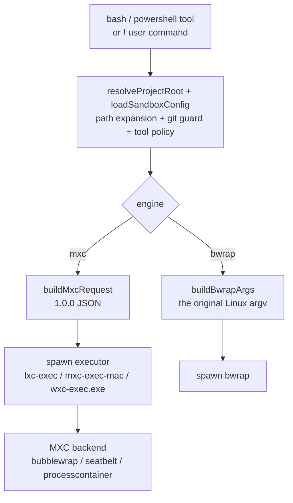
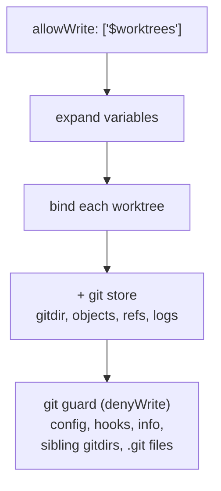

# pi-bash-sandbox

OS-level sandboxing for [pi](https://pi.dev/)'s `bash` tool, backed by
[MXC](https://github.com/microsoft/mxc) (Microsoft eXecution Container), with
[bubblewrap](https://github.com/containers/bubblewrap) retained as the Linux
fallback engine.

> [简体中文](README.zh-CN.md)

- **Three platforms.** Linux → MXC `bubblewrap`; macOS → MXC `seatbelt`;
  Windows → MXC `processcontainer`.
- **Per-project, stateless.** Every command resolves its own policy and spawns a
  fresh sandbox. No long-lived sandbox process, no global singletons.
- **Filesystem, network, and environment control** via a user-editable
  `sandbox.json`, merged from global + project layers.
- **Also gates the built-in file tools** (`read` / `write` / `edit` /
  `grep` / `find` / `ls`), which do not run inside the sandbox.
- **Fail-closed** by default; `engine: "auto" | "mxc" | "bwrap"` selects the
  engine and `onUnavailable` decides between erroring and running unsandboxed.

## Requirements

| Platform | Default engine | Requirements |
|---|---|---|
| Linux | MXC `bubblewrap` | `bwrap` ≥ 0.4; `network: "host"` also needs `slirp4netns`, iproute2, and iptables, otherwise `auto` falls back to bwrap |
| Windows 11 | MXC `processcontainer` | 24H2 ≥ 26100.9278 / 25H2 / 26H2 / 26H1; `busybox.exe` on PATH or `mxc.busyboxPath` |
| macOS 15+ | MXC `seatbelt` | The published npm package ships **arm64 only**; Intel Macs must build MXC from source |

pi itself requires Node ≥ 22.19. The extension drives MXC's standalone
executors (`lxc-exec` / `mxc-exec-mac` / `wxc-exec.exe`), so it does **not**
require Node 24 and does not load native FFI into the agent process.
`@microsoft/mxc-sdk` is a runtime dependency (~108 MB unpacked, containing
binaries for every platform).

```bash
# Linux: bwrap + network provider
sudo apt install bubblewrap slirp4netns iproute2 iptables   # Debian/Ubuntu
sudo dnf install bubblewrap slirp4netns iproute iptables     # Fedora/RHEL

# Windows: BusyBox-w32 (Git Bash cannot run inside ProcessContainer)
scoop install busybox
# or download https://frippery.org/files/busybox/busybox64.exe and set mxc.busyboxPath
```

On Ubuntu 24.04+ AppArmor restricts unprivileged user namespaces. If the bwrap
probe reports `userns=false`, see `weakerNestedSandbox` below.

> The repository ships an `.npmrc` that maps the `@microsoft` scope to the
> official npm registry. Some mirrors still serve MXC 0.8.x, which lacks the
> 1.0.0 CLI/contract used here.

## Install

```bash
# Try it without installing
pi -e /path/to/pi-bash-sandbox

# Install as an extension (from a git source)
pi install git:github.com/loong95/pi-bash-sandbox
```

Verify inside a session:

```
/sandbox
```

## Quick start

Create `~/.pi/agent/sandbox.json` (global) or `<project>/.pi/sandbox.json`
(project):

```json
{
  "enabled": true,
  "engine": "auto",
  "mxc": {
    "backend": "auto",
    "shell": "busybox"
  },
  "network": "none",
  "filesystem": {
    "allowWrite": [".", "/tmp"],
    "denyWrite": ["~/.ssh", ".env", ".env.*", "*.pem", "*.key"],
    "denyRead": ["~/.ssh", "~/.aws", "~/.gnupg", "~/.config/gh"]
  },
  "tmp": "private",
  "tools": { "enabled": true, "requireAllowWrite": true }
}
```

With no config at all, these built-in defaults apply. Note the default
`network: "none"` blocks `git push`, `pnpm install`, `curl`, etc. Set
`"network": "host"` if you need outbound access.

To commit from a linked worktree, use
`allowWrite: ["$worktrees", "/tmp"]` (see "Path variables" below).

## How it works



The `bash` tool is overridden by name; pi's built-in renderers, truncation,
streaming updates, and timeout handling are reused. `!` / `!!` user commands are
routed through the same operations via the `user_bash` event. On Windows the
built-in `powershell` tool is overridden as well.

Engine selection:

- `auto` (default): MXC on Linux when available; falls back to bwrap when MXC
  is missing or `network: "host"` has no `slirp4netns`. Windows/macOS always use
  MXC.
- `mxc`: MXC only; `onUnavailable` decides what happens when it cannot run.
- `bwrap`: the original bubblewrap engine (Linux only).

### Policy mapping

| Config | MXC field | Meaning |
|---|---|---|
| `filesystem.allowWrite` | `filesystem.readwritePaths` | writable paths |
| `filesystem.denyWrite` | `filesystem.readonlyPaths` | readable, not writable |
| `filesystem.denyRead` | `filesystem.deniedPaths` | masked (tmpfs / `/dev/null`) |
| `tmp: "private"` | no `/tmp` grant | MXC gives Linux a tmpfs; Windows uses the AppContainer temp |
| `tmp: "shared"` | add the host temp to `readwritePaths` | shared host temp directory |
| `network: "none"` | egress/ingress/hostLoopback deny | private network namespace |
| `network: "host"` | Linux: egress allow + ingress/hostLoopback deny; Windows/macOS: all allow | see platform notes |
| `env.*` | `process.env` | the extension filters first; MXC clears and sets only these |
| git guard | `readonlyPaths` / `deniedPaths` | identical to the bwrap engine |

To preserve the old "host is readable" model, the MXC request automatically
adds read-only roots: on Linux every entry under `/` except `/dev`, `/proc`,
`/sys`, and `/tmp`; on macOS `/`; on Windows every existing drive root
(`C:\`, `D:\`, ...). Roots the current user cannot read are filtered out,
because MXC's delegation check would reject the whole request.

### Windows shells

Windows ProcessContainer calls `CreateProcessW` directly; there is no outer
shell. BusyBox-w32 is the default:

```json
{ "mxc": { "shell": "busybox", "busyboxPath": "C:\\tools\\busybox.exe" } }
```

- `shell: "busybox"` (default): POSIX `sh`; needs Win32k, so the request sets
  `ui.disable: false`.
- `shell: "powershell"`: native PowerShell, also needs Win32k. The built-in
  `powershell` tool always uses this.
- `shell: "cmd"`: native `cmd.exe`; UI can stay fully disabled, but command
  semantics are the weakest.
- BusyBox ash is POSIX: bash arrays, process substitution (`<(...)`), and some
  `[[ ... ]]` extensions are not available. Use `powershell` for Windows-native
  scripting.
- Any other string is treated as an executable and invoked as `<exe> -c <command>`.

**Git Bash does not work.** MSYS2/Cygwin creates
`\BaseNamedObjects\msys-2.0S5-…` during startup, but ProcessContainer
isolates the object namespace. It fails with
`NtCreateDirectoryObject ... 0xC0000022` / `STATUS_DLL_INIT_FAILED`; no policy
setting can lift that.

Other Windows differences: `/dev/null` works for shell redirections but native
programs resolve it as `C:\dev\null`, so pass `NUL` to tools like
`curl -o`; MSYS paths such as `/c/Windows` do not exist — use `C:/Windows`.

## Configuration

### Locations and precedence

| Scope | Path |
|---|---|
| Global | `~/.pi/agent/sandbox.json` (respects `PI_CODING_AGENT_DIR`) |
| Project | `<project>/.pi/sandbox.json` (only when the project is trusted) |

Merging order: **built-in defaults ← global ← project**. Project array fields
extend the corresponding global arrays by default, with duplicates removed. To
replace selected global arrays instead, list their dotted names in the
project's `replaceGlobalArrays` field:

```json
{
  "replaceGlobalArrays": ["filesystem.allowWrite", "env.deny"],
  "filesystem": {
    "allowWrite": ["./dist"],
    "denyRead": ["./local-secrets"]
  },
  "env": {
    "deny": ["PROJECT_*"]
  }
}
```

In this example, `filesystem.allowWrite` and `env.deny` use only the project
values, while `filesystem.denyRead` remains global plus project. Supported
array names are `filesystem.allowWrite`, `filesystem.denyWrite`,
`filesystem.denyRead`, `env.passthrough`, and `env.deny`. If the project does
not define an array, it continues to inherit the global value. `env.set` always
merges per key. `extraBwrapArgs` remains replacement-only because argument
ordering can affect sandbox behavior. For linked worktrees, the worktree's own
`.pi/sandbox.json` is used when present, otherwise the main checkout's.

`enabled` follows the same layering: set it globally to change the default for
every project, or in a project config to override just that project.
`/sandbox-enable` and `/sandbox-disable` write it for you.

### Schema

| Field | Type | Default | Meaning |
|---|---|---|---|
| `replaceGlobalArrays` | string[] | `[]` | Project array fields that replace, rather than extend, the corresponding global arrays (dotted names) |
| `enabled` | boolean | `true` | Master switch |
| `engine` | `"auto"` \| `"mxc"` \| `"bwrap"` | `"auto"` | Execution engine |
| `mxc.backend` | `"auto"` \| `"bubblewrap"` \| `"seatbelt"` \| `"processcontainer"` | `"auto"` | Override the platform default backend |
| `mxc.shell` | string | `"busybox"` | Windows shell: `busybox` / `powershell` / `cmd` / executable path |
| `mxc.busyboxPath` | string | — | Explicit `busybox.exe` location |
| `mxc.executorPath` | string | — | Override the MXC executor (advanced/testing) |
| `mxc.extraReadwritePaths` | string[] | `[]` | Additional writable paths (also added to the tool policy) |
| `mxc.extraReadonlyPaths` | string[] | `[]` | Additional read-only paths |
| `mxc.extraDeniedPaths` | string[] | `[]` | Additional masked paths |
| `network` | `"none"` \| `"host"` | `"none"` | `none`: private network namespace; `host`: outbound allowed |
| `filesystem.allowWrite` | string[] | `[".", "/tmp"]` | Writable paths (everything else is read-only) |
| `filesystem.denyWrite` | string[] | `["~/.ssh", ".env", ".env.*", "*.pem", "*.key"]` | Read-only paths |
| `filesystem.denyRead` | string[] | `["~/.ssh", "~/.aws", "~/.gnupg", "~/.config/gh"]` | Hidden paths |
| `tmp` | `"private"` \| `"shared"` | `"private"` | `private` mounts an empty `/tmp` |
| `env.passthrough` | string[] | `["PATH","HOME","TERM","LANG","LC_*","TMPDIR","PI_*"]` | Variables kept from pi's env (globs allowed) |
| `env.deny` | string[] | `["*_KEY","*_TOKEN","*_SECRET","*_PASSWORD","ANTHROPIC_*","OPENAI_*"]` | Variables removed (wins over passthrough) |
| `env.set` | object | `{}` | Variables forced to a value |
| `unsharePid` | boolean | `true` | bwrap only: isolate pid/ipc/uts/cgroup; MXC always isolates |
| `weakerNestedSandbox` | boolean | `false` | bwrap only: bind host `/proc` (for containers without `CAP_SYS_ADMIN`) |
| `onUnavailable` | `"error"` \| `"fallback"` | `"error"` | What to do when the selected engine is unusable |
| `extraBwrapArgs` | string[] | `[]` | bwrap only: appended verbatim before `--`. Powerful and risky |
| `tools.enabled` | boolean | `true` | Gate `read`/`write`/`edit`/`grep`/`find`/`ls` via `tool_call` |
| `tools.requireAllowWrite` | boolean | `true` | `write`/`edit` targets must be inside `allowWrite` |

Path rules support `~` expansion, relative paths (resolved against the command
cwd), globs (`*`, `?`, `**`), and path variables. A bare relative pattern such
as `.env` or `*.pem` matches by basename (case-insensitively on Windows). Rules
that match nothing are skipped — both engines can only constrain existing
paths — while the tool policy matches the raw patterns, so `.env.*` protects
files created later too.

### Path variables

Worktree directories are machine- and branch-specific, so hard-coding them in
`sandbox.json` cannot work. Three variables are substituted in any path rule:

| Variable | Expands to |
|---|---|
| `$repo` | Main checkout root (shared by every worktree) |
| `$worktree` | Toplevel of the worktree the command runs in |
| `$worktrees` | Every worktree root, main checkout first (**multi-valued**) |

`$worktrees` is multi-valued: one rule expands into one rule per worktree, so
`allowWrite: ["$worktrees"]` covers every linked worktree, including ones
created after the session started. Expansion re-runs on every command, and the
resolved worktree set is refreshed as soon as `git worktree add`/`remove`
touches the repository (a short-lived cache is invalidated by the worktree
directory's mtime, not only by the TTL).

```json
{
  "filesystem": {
    "allowWrite": ["$worktrees", "/tmp"],
    "denyWrite": ["~/.ssh", ".env", "*.pem"]
  }
}
```

A literal `$` is written `\$`. Unknown `$name` references are reported in the
`/sandbox` warnings and left verbatim, so the rule simply never matches.

`$worktree` instead of `$worktrees` keeps each worktree isolated from its
siblings — the variables are general, not just a way to widen access.

### Automatic git protection

When a repository is detected, the sandbox derives extra rules from the git
layout. **This needs no configuration**; `/sandbox` reports it as `git guard`.

Two paths inside a git dir are host code execution, because git runs them
*outside* the sandbox on the next command: `.git/config` / `config.worktree`
(via `core.hooksPath`) and the hooks directory. Guards cover those, plus
`info`, every sibling worktree's private gitdir, the main checkout's
`HEAD`/`index`/`ORIG_HEAD`, and every worktree's `.git` pointer file, so one
worktree cannot damage another's state or repoint a gitdir pointer. Guards are
emitted as `denyWrite`, so they win over any `allowWrite`, including `$repo`
and `$worktrees`.

Three cases are easy to get wrong, and are handled explicitly:

- **Every hooks candidate.** A relative `core.hooksPath` (the husky default,
  `.husky/_`) resolves against whichever cwd git runs in, so the host may
  execute a hook from a different directory than this command would resolve.
  Every candidate is guarded, not just the current one.
- **Paths that do not exist yet.** bwrap creates the destination of a bind, so
  read-only-binding a missing file leaves a 0-byte artifact on the host — and
  for a missing *directory* it leaves a file, which breaks a later `mkdir -p`.
  Such paths are masked instead (`tmpfs` for a directory, `/dev/null` for a
  file). `config.worktree` is masked when absent but only while
  `extensions.worktreeConfig` is on, since otherwise git never reads it.
- **Symlinks.** Guards record realpath-resolved paths, because the tool policy
  canonicalizes its targets. A lexically recorded guard would miss a symlinked
  `.git/config` and let the `write` tool through.

Referencing a git variable in `allowWrite` additionally opens the store a
commit needs: the worktree's private gitdir plus the shared `objects`, `refs`,
and `logs`. This is opt-in, and only `allowWrite` counts — mentioning
`$worktrees` in `denyWrite` cannot silently widen what may be written. Without
a git variable nothing is opened, so a config of literal paths cannot commit
from a linked worktree.



Guards only name paths that already exist, except where creating them would be
a vector: `config.worktree` (while `extensions.worktreeConfig` is on) and a
hooks directory that does not exist yet are masked rather than read-only bound.
`git worktree add` is deliberately *not* opened — it would require writable
`config`, which is the hook-execution vector. Create worktrees with git itself.

### Tool policy semantics

`read` / `grep` / `find` / `ls` are blocked when their `path` (default: cwd)
matches a `denyRead` rule. `write` / `edit` are blocked on `denyRead` or
`denyWrite`, and by default must land inside `allowWrite`. Set
`tools.requireAllowWrite: false` to relax the containment check while keeping the
deny lists. The git guards apply here too, so the built-in `write` tool cannot
reach a path the bash sandbox would refuse.

## Commands

| Command | Description |
|---|---|
| `/sandbox` | Show the resolved config, config sources, and engine/MXC/bwrap status |
| `/sandbox-test <command>` | Dry-run: print the MXC 1.0.0 JSON (or the bwrap argv with `engine: "bwrap"`) without executing |
| `/sandbox-why <path>` | Explain how a path is treated (which rules match, bash vs tool policy) |
| `/sandbox-init` | Create a `.pi/sandbox.json` template in the current project |
| `/sandbox-enable [project\|global]` | Write `enabled: true` (default scope: project) |
| `/sandbox-disable [project\|global]` | Write `enabled: false` (default scope: project) |
| `/sandbox-reload` | Clear all caches (config, bwrap/MXC probes, project, settings) |
| `--no-sandbox` | Disable both the bash sandbox and the tool policy for this session |

## Security model and limitations

**What is isolated**

- `bash` / `!` / `!!` (and `powershell` on Windows) run inside MXC's
  bubblewrap / Seatbelt / ProcessContainer with a clean environment.
- `read` / `write` / `edit` / `grep` / `find` / `ls` are gated by a `tool_call`
  policy using the same rules (this is policy, not OS isolation).

**Platform notes**

- **Linux `network: "host"` has no host loopback.** Bubblewrap lives in a
  private netns and reaches the internet through `slirp4netns`;
  `ingress.default` and `hostLoopback` must be `deny`. A dev server on the
  host's `localhost:3000` is not reachable from the sandbox. Use
  `network: "none"` or the bwrap engine when you need loopback.
- **Windows requires BusyBox.** Git Bash/msys2 cannot initialize inside
  ProcessContainer (see above).
- **macOS prebuilt binaries are arm64 only.** Intel Macs must build
  `mxc-exec-mac` / `libmxc_ffi.dylib` from MXC source, or use
  `onUnavailable: "fallback"`.
- **Windows drive roots are readable.** Every existing drive root is added
  read-only, matching the old `--ro-bind / /` model. Sensitive directories rely
  on `denyRead`; narrow the policy explicitly for stronger isolation.

**Known limitations**

- **Project-to-project reads.** A read-only host root means any project can read
  any other unless you add it to `denyRead`. Use explicit `denyRead` entries or
  a minimal-root configuration for stronger isolation.
- **`$worktrees` is a shared write surface.** One rule grants every worktree, so
  an agent in worktree A can modify worktree B's files. Use `$worktree` when you
  want each checkout isolated instead.
- **`git worktree add` is not opened.** It needs a writable `.git/worktrees`,
  which is exactly the directory that must stay read-only to keep hooks safe.
  Create worktrees with git itself.
- **The tool policy is best-effort.** It blocks the built-in file tools, but a
  custom extension tool or the pi-web web terminal / file browser is not covered.
- **Interactive TTY commands** (vim, htop) are not supported inside the sandbox.
- **Heavy globs.** Path/glob rules are re-expanded on every command so newly
  created files are picked up immediately. A recursive pattern like `**/*.pem`
  walks the tree per command; prefer targeted patterns.
- **`extraBwrapArgs` is a loaded gun.** It is appended verbatim (bwrap engine only).
- **MXC `denyRead` masks rather than audits.** It covers the target with tmpfs /
  `/dev/null`; a masked directory appears empty inside the sandbox.
- **Windows `/dev/null` arguments.** Shell redirections work, but passing
  `/dev/null` to a native program (e.g. `curl -o /dev/null`) resolves to
  `C:\dev\null`; use `NUL` instead.

## Development

```bash
pnpm install
pnpm test        # unit + real-bwrap integration (auto-skips without bwrap)
pnpm run check   # tsc --noEmit
pnpm run all     # check + test
```

| Path | Purpose |
|---|---|
| `src/config.ts` | Config discovery, layering, validation, path expansion, git layer |
| `src/project.ts` | cwd → project root / worktree root / git layout |
| `src/variables.ts` | `$repo` / `$worktree` / `$worktrees` expansion |
| `src/bwrap.ts` | Pure `buildBwrapArgs` (bwrap engine) |
| `src/mxc/request.ts` | `ResolvedSandboxConfig` → MXC 1.0.0 request |
| `src/mxc/shell.ts` | POSIX / Windows busybox / PowerShell / cmd command construction |
| `src/mxc/probe.ts` | Executor lookup and backend probe |
| `src/mxc/network.ts` | Linux network prerequisites (`slirp4netns`) |
| `src/mxc/exec.ts` | Executor spawn, streaming, abort/timeout |
| `src/env.ts` | Environment allow/deny matching (case-insensitive on Windows) |
| `src/probe.ts` | bwrap availability and capability detection |
| `src/exec.ts` | `SandboxedBashOperations` dispatcher |
| `src/policy.ts` | `tool_call` policy for the built-in file tools |
| `src/config-write.ts` | Config writes for `/sandbox-init` and enable/disable |
| `src/settings.ts` | Reads `shellCommandPrefix` / `shellPath` from pi settings |
| `src/ui.ts` | `/sandbox` output |

Integration tests exercise the selected engine (MXC or bwrap) and skip when it
is unavailable. Unit tests pin the MXC request builder, Windows shell
resolution, probes, and engine selection. Windows was validated end to end with
`wxc-exec.exe` + BusyBox-w32 for success, denied paths, network, timeout,
abort, and PowerShell.

## License

MIT
