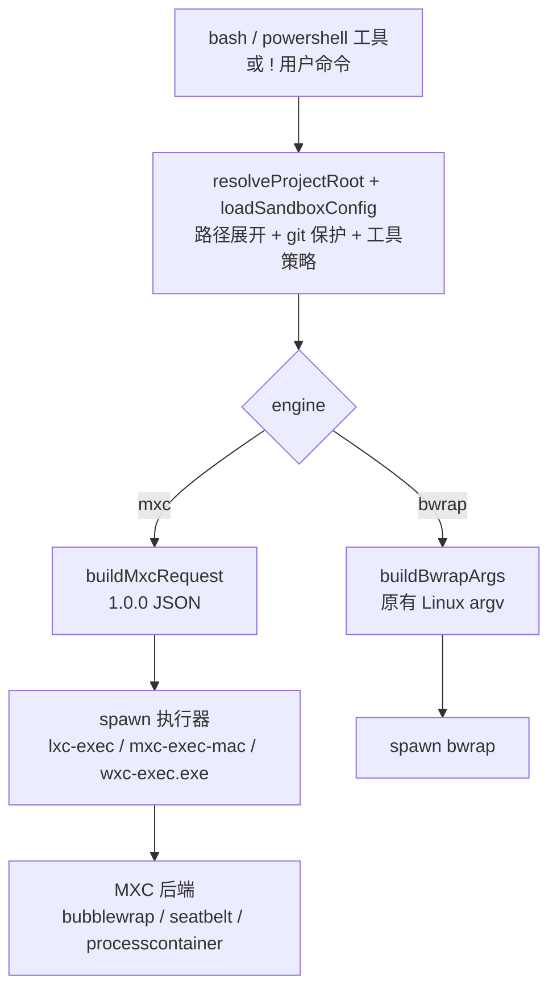
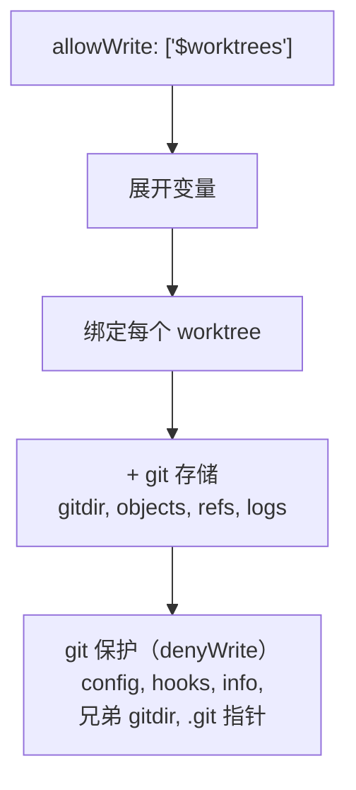

# pi-bash-sandbox

用 [MXC](https://github.com/microsoft/mxc)（Microsoft eXecution Container）为
[pi](https://pi.dev/) 的 `bash` 工具提供 OS 级沙箱；Linux 上保留
[bubblewrap](https://github.com/containers/bubblewrap) 作为回退引擎。

> [English](README.md)

- **三平台。** Linux → MXC `bubblewrap`；macOS → MXC `seatbelt`；Windows → MXC `processcontainer`。
- **按项目、无状态。** 每条命令各自解析策略、各自启动一个新的沙箱。没有常驻沙箱进程，没有全局单例。
- **文件系统、网络、环境变量可控**，通过可编辑的 `sandbox.json` 合并全局层与项目层。
- **同时拦截内置文件工具**（`read` / `write` / `edit` / `grep` / `find` / `ls`）——它们不跑在沙箱里。
- **默认 fail-closed**；`engine: "auto" | "mxc" | "bwrap"` 选择引擎，MXC 不可用时按
  `onUnavailable` 报错或回退。

## 环境要求

| 平台 | 默认引擎 | 要求 |
|---|---|---|
| Linux | MXC `bubblewrap` | `bwrap` ≥ 0.4；`network: "host"` 还需要 `slirp4netns`、iproute2、iptables，否则 `auto` 会回退到 bwrap |
| Windows 11 | MXC `processcontainer` | 24H2 ≥ 26100.9278 / 25H2 / 26H2 / 26H1；`busybox.exe` 在 PATH 或配置 `mxc.busyboxPath` |
| macOS 15+ | MXC `seatbelt` | 预编译的 npm 包只带 **arm64**；Intel Mac 需要自行构建 MXC |

pi 本身要求 Node ≥ 22.19。扩展通过 MXC 的独立执行器（`lxc-exec` /
`mxc-exec-mac` / `wxc-exec.exe`）调用，**不要求 Node 24**，也不把原生 FFI
加载进 agent 进程。`@microsoft/mxc-sdk` 是运行时依赖，未压缩约 108MB（含各平台二进制）。

```bash
# Linux：bwrap 与联网依赖
sudo apt install bubblewrap slirp4netns iproute2 iptables   # Debian/Ubuntu
sudo dnf install bubblewrap slirp4netns iproute iptables     # Fedora/RHEL

# Windows：BusyBox-w32（Git Bash 不能在 ProcessContainer 里运行）
scoop install busybox
# 或下载 https://frippery.org/files/busybox/busybox64.exe 后写进 mxc.busyboxPath
```

Ubuntu 24.04+ 的 AppArmor 会限制非特权 user namespace。如果 bwrap 探测报告
`userns=false`，见下文的 `weakerNestedSandbox`。

> 仓库自带 `.npmrc`，把 `@microsoft` 作用域固定到官方 registry。部分镜像仍停留在
> MXC 0.8.x，缺少这里使用的 1.0.0 执行器和契约。

## 安装

```bash
# 免安装试用
pi -e /path/to/pi-bash-sandbox

# 作为扩展安装（git 源）
pi install git:github.com/loong95/pi-bash-sandbox
```

在会话里验证：

```
/sandbox
```

## 快速开始

创建 `~/.pi/agent/sandbox.json`（全局）或 `<项目>/.pi/sandbox.json`（项目）：

```json
{
  "enabled": true,
  "engine": "auto",
  "mxc": {
    "backend": "auto",
    "shell": "busybox"
  },
  "network": "none",
  "filesystem": {
    "allowWrite": [".", "/tmp"],
    "denyWrite": ["~/.ssh", ".env", ".env.*", "*.pem", "*.key"],
    "denyRead": ["~/.ssh", "~/.aws", "~/.gnupg", "~/.config/gh"]
  },
  "tmp": "private",
  "tools": { "enabled": true, "requireAllowWrite": true }
}
```

完全不写配置时，使用同一套内置默认值。默认 `network: "none"` 会挡住
`git push`、`pnpm install`、`curl` 等；需要联网时改成 `"network": "host"`。

要在 linked worktree 里提交，把 `allowWrite` 改成 `["$worktrees", "/tmp"]`
（见下方“路径变量”）。

## 工作原理



`bash` 工具按名字覆盖；pi 内置的渲染、输出截断、流式更新、timeout 处理全部复用。
`!` / `!!` 用户命令也通过 `user_bash` 事件走同一套 operations。Windows 上还会覆盖内置
`powershell` 工具，使其同样经过 MXC。

引擎选择：

- `auto`（默认）：Linux 优先 MXC，不可用或 `network: "host"` 缺少 `slirp4netns`
  时回退 bwrap；Windows/macOS 固定 MXC。
- `mxc`：只用 MXC；不可用时按 `onUnavailable` 报错或回退。
- `bwrap`：只用原有 bubblewrap 引擎（仅 Linux）。

### 策略映射

| 配置 | MXC 字段 | 语义 |
|---|---|---|
| `filesystem.allowWrite` | `filesystem.readwritePaths` | 可写路径 |
| `filesystem.denyWrite` | `filesystem.readonlyPaths` | 可读不可写 |
| `filesystem.denyRead` | `filesystem.deniedPaths` | 完全遮蔽（tmpfs / `/dev/null`） |
| `tmp: "private"` | 不授予 `/tmp` | MXC 在 Linux 自带 tmpfs；Windows 使用 AppContainer 私有 temp |
| `tmp: "shared"` | `readwritePaths` 加宿主 temp | 共享宿主临时目录 |
| `network: "none"` | egress/ingress/hostLoopback 全 deny | 私有网络命名空间 |
| `network: "host"` | Linux：egress allow + ingress/hostLoopback deny；Windows/macOS：全 allow | 见下方平台差异 |
| `env.*` | `process.env` | 扩展先过滤环境，MXC 清空后只设置这些变量 |
| git 保护 | `readonlyPaths` / `deniedPaths` | 与 bwrap 引擎一致 |

为了让“宿主可读”的旧模型成立，MXC 引擎会自动把只读根加入 `readonlyPaths`：
Linux 是 `/` 下除 `/dev`、`/proc`、`/sys`、`/tmp` 之外的目录；macOS 是 `/`；
Windows 是所有存在的盘符根（`C:\`、`D:\` …）。当前用户读不到的目录会被过滤，
避免 MXC 的 delegation 检查拒绝整个请求。

### Windows 的 shell

Windows ProcessContainer 直接 `CreateProcessW`，没有外层 shell。默认用
BusyBox-w32：

```json
{ "mxc": { "shell": "busybox", "busyboxPath": "C:\\tools\\busybox.exe" } }
```

- `shell: "busybox"`（默认）：POSIX `sh`，需要 Win32k，扩展会自动设 `ui.disable: false`。
- `shell: "powershell"`：原生 PowerShell，同样需要 Win32k；内置 `powershell` 工具固定走这个。
- `shell: "cmd"`：原生 `cmd.exe`，可完全关闭 UI，但命令语义最弱。
- BusyBox 是 POSIX shell：bash 数组、进程替换（`<(...)`）以及部分 `[[ ... ]]`
  扩展不可用。需要 Windows 原生脚本时请用 `powershell`。
- 其它字符串按可执行文件路径处理，以 `<exe> -c <command>` 调用。

**Git Bash 不能用。** MSYS2/Cygwin 在启动时创建
`\BaseNamedObjects\msys-2.0S5-…`，而 ProcessContainer 的对象命名空间隔离了它，
会报 `NtCreateDirectoryObject ... 0xC0000022` / `STATUS_DLL_INIT_FAILED`。这不是策略能放宽的。

Windows 命令的其它差异：`/dev/null` 只对 shell 重定向有效，传给原生程序时要写 `NUL`；
`/c/Windows` 这类 MSYS 路径不存在，应使用 `C:/Windows` 或 `C:\\Windows`。

## 配置

### 位置与优先级

| 作用域 | 路径 |
|---|---|
| 全局 | `~/.pi/agent/sandbox.json`（尊重 `PI_CODING_AGENT_DIR`） |
| 项目 | `<项目>/.pi/sandbox.json`（仅当项目被信任时加载） |

合并顺序：**内置默认 ← 全局 ← 项目**。项目数组默认会拼接对应的全局数组，并自动去重。
如果需要让某些数组只使用项目值，可以在项目配置的 `replaceGlobalArrays` 中列出它们的点号路径：

```json
{
  "replaceGlobalArrays": ["filesystem.allowWrite", "env.deny"],
  "filesystem": {
    "allowWrite": ["./dist"],
    "denyRead": ["./local-secrets"]
  },
  "env": {
    "deny": ["PROJECT_*"]
  }
}
```

上例中，`filesystem.allowWrite` 和 `env.deny` 只使用项目值，
而 `filesystem.denyRead` 仍然是全局值加项目值。支持的数组字段为
`filesystem.allowWrite`、`filesystem.denyWrite`、`filesystem.denyRead`、
`env.passthrough` 和 `env.deny`。项目未声明某个数组时，继续继承全局值。
`env.set` 始终按 key 合并。`extraBwrapArgs` 仍然只覆盖不拼接，因为参数顺序可能影响沙箱行为。
linked worktree 优先用自己那份 `.pi/sandbox.json`，没有则回退到主 checkout 的。

`enabled` 同样遵循这套分层：写在全局就是所有项目的默认开关，写在项目里就只覆盖该项目。
`/sandbox-enable` 和 `/sandbox-disable` 会帮你写入。

### 字段

| 字段 | 类型 | 默认值 | 含义 |
|---|---|---|---|
| `replaceGlobalArrays` | string[] | `[]` | 项目级配置中需要替换而不是继承全局值的数组字段（使用点号路径） |
| `enabled` | boolean | `true` | 总开关 |
| `engine` | `"auto"` \| `"mxc"` \| `"bwrap"` | `"auto"` | 执行引擎 |
| `mxc.backend` | `"auto"` \| `"bubblewrap"` \| `"seatbelt"` \| `"processcontainer"` | `"auto"` | 覆盖平台默认后端 |
| `mxc.shell` | string | `"busybox"` | Windows shell：`busybox` / `powershell` / `cmd` / 可执行文件路径 |
| `mxc.busyboxPath` | string | — | 显式指定 `busybox.exe` |
| `mxc.executorPath` | string | — | 覆盖 MXC 执行器（高级/测试） |
| `mxc.extraReadwritePaths` | string[] | `[]` | 额外可写路径（会追加到工具策略） |
| `mxc.extraReadonlyPaths` | string[] | `[]` | 额外只读路径 |
| `mxc.extraDeniedPaths` | string[] | `[]` | 额外遮蔽路径 |
| `network` | `"none"` \| `"host"` | `"none"` | `none`：私有网络命名空间；`host`：允许出网 |
| `filesystem.allowWrite` | string[] | `[".", "/tmp"]` | 可写路径（其余只读） |
| `filesystem.denyWrite` | string[] | `["~/.ssh", ".env", ".env.*", "*.pem", "*.key"]` | 只读路径 |
| `filesystem.denyRead` | string[] | `["~/.ssh", "~/.aws", "~/.gnupg", "~/.config/gh"]` | 被隐藏的路径 |
| `tmp` | `"private"` \| `"shared"` | `"private"` | `private` 挂一个空的 `/tmp` |
| `env.passthrough` | string[] | `["PATH","HOME","TERM","LANG","LC_*","TMPDIR","PI_*"]` | 从 pi 环境保留的变量（支持 glob） |
| `env.deny` | string[] | `["*_KEY","*_TOKEN","*_SECRET","*_PASSWORD","ANTHROPIC_*","OPENAI_*"]` | 被移除的变量（优先级高于 passthrough） |
| `env.set` | object | `{}` | 强制设置的变量 |
| `unsharePid` | boolean | `true` | 仅 bwrap：隔离 pid/ipc/uts/cgroup；MXC 总是隔离 |
| `weakerNestedSandbox` | boolean | `false` | 仅 bwrap：绑定宿主 `/proc`（用于没有 `CAP_SYS_ADMIN` 的容器） |
| `onUnavailable` | `"error"` \| `"fallback"` | `"error"` | 所选引擎不可用时怎么办 |
| `extraBwrapArgs` | string[] | `[]` | 仅 bwrap：原样追加到 `--` 之前。强大且危险 |
| `tools.enabled` | boolean | `true` | 通过 `tool_call` 拦截 `read`/`write`/`edit`/`grep`/`find`/`ls` |
| `tools.requireAllowWrite` | boolean | `true` | `write`/`edit` 目标必须在 `allowWrite` 内 |

路径规则支持 `~` 展开、相对路径（相对命令 cwd 解析）、glob（`*`、`?`、`**`）以及路径变量。
不带分隔符的相对模式（如 `.env`、`*.pem`）按 basename 匹配（Windows 上不区分大小写）。
匹配不到任何文件的规则会被跳过——两个引擎都只能约束已存在的路径；而工具策略匹配的是
**原始模式**，所以 `.env.*` 对之后才创建的文件同样有效。

### 路径变量

worktree 目录跟机器、分支都相关，硬编码进 `sandbox.json` 不可行。任何路径规则里都可以用这三个变量：

| 变量 | 展开为 |
|---|---|
| `$repo` | 主 checkout 根（所有 worktree 共享） |
| `$worktree` | 命令所在 worktree 的 toplevel |
| `$worktrees` | 所有 worktree 根，主 checkout 在最前（**多值**） |

`$worktrees` 是多值的：一条规则展开成每个 worktree 一条，所以
`allowWrite: ["$worktrees"]` 一次覆盖所有 linked worktree，**包括会话启动后才新建的**
（每条命令都重新展开；worktree 集合的缓存会被 `git worktree add`/`remove` 改动的目录 mtime
立即失效，不必等 TTL 到期）。

```json
{
  "filesystem": {
    "allowWrite": ["$worktrees", "/tmp"],
    "denyWrite": ["~/.ssh", ".env", "*.pem"]
  }
}
```

字面量 `$` 写作 `\$`。未知的 `$name` 会在 `/sandbox` 里告警并原样保留，因此该规则永不命中。

用 `$worktree` 而不是 `$worktrees`，则各 worktree 互相隔离——变量是通用能力，不只是用来放开权限。

### 自动 git 保护

检测到 git 仓库时，沙箱会从 git 布局自动推导额外规则。**无需配置**，`/sandbox` 会以 `git guard` 展示。

git 目录里有两个路径等同于宿主机代码执行，因为 git 会在沙箱**之外**执行它们：
`.git/config` / `config.worktree`（通过 `core.hooksPath`）和 hooks 目录。保护层覆盖这两者，另加
`info`、每个兄弟 worktree 的私有 gitdir、主 checkout 的 `HEAD`/`index`/`ORIG_HEAD`、
以及每个 worktree 的 `.git` 指针文件，使得一个 worktree 无法破坏另一个的状态，也无法重定向 gitdir 指针。
保护以 `denyWrite` 下发，因此**优先于**任何 `allowWrite`，包括 `$repo` 和 `$worktrees`。

三种容易做错的情况都已显式处理：

- **所有 hooks 候选。** 相对的 `core.hooksPath`（husky 默认的 `.husky/_`）按 git 运行时的 cwd 解析，
  因此宿主机可能执行到与本条命令不同的目录。保护层覆盖每个候选，而不只是当前这一个。
- **尚不存在的路径。** `bwrap` 会创建 bind 的目标，所以对不存在的文件做只读绑定会在宿主机留下 0 字节残留；
  对不存在的**目录**则会留下一个文件，导致之后的 `mkdir -p` 失败。这类路径改为**遮蔽**
  （目录用 `tmpfs`，文件用 `/dev/null`）。`config.worktree` 仅在
  `extensions.worktreeConfig` 打开时才遮蔽（否则 git 根本不会读它）。
- **符号链接。** 保护记录的是 realpath 解析后的路径，因为工具策略会对目标做归一化；
  若按字面路径记录，符号链接的 `.git/config` 就会被漏掉，`write` 工具即可穿透。

引用 git 变量时，还会额外打开提交所必需的 git 存储：worktree 的私有 gitdir
以及共享的 `objects`、`refs`、`logs`。这是选择性开放，且**只认 `allowWrite`**——
在 `denyWrite` 里提到 `$worktrees` 不会意外放宽可写范围。
若不用任何 git 变量，则什么都不打开，纯字面量路径的配置在 linked worktree 里无法提交。



保护层只列举**已存在**的路径，除非创建它们本身就是攻击面：
`config.worktree`（`extensions.worktreeConfig` 打开时）和尚未存在的 hooks 目录会改为遮蔽而非只读绑定。
`git worktree add` 故意**不**放开——它需要可写的 `config`，而那正是 hook 执行通道。请用 git 本身创建 worktree。

### 工具策略语义

`read` / `grep` / `find` / `ls` 的 `path`（默认 cwd）命中 `denyRead` 时被拦截。
`write` / `edit` 命中 `denyRead` 或 `denyWrite` 时被拦截，且默认必须落在 `allowWrite` 内。
把 `tools.requireAllowWrite` 设为 `false` 可以只保留 deny 列表、放宽写入范围限制。
git 保护在这里同样生效，所以内置 `write` 工具也够不到 bash 沙箱会拒绝的路径。

## 命令

| 命令 | 说明 |
|---|---|
| `/sandbox` | 展示解析后的配置、配置来源、引擎/MXC/bwrap 状态 |
| `/sandbox-test <command>` | 干跑：默认打印 MXC 1.0.0 JSON（`engine: "bwrap"` 时打印 bwrap argv），不执行 |
| `/sandbox-why <path>` | 解释某路径如何被处理（命中哪些规则、bash vs 工具策略） |
| `/sandbox-init` | 在当前项目生成 `.pi/sandbox.json` 模板 |
| `/sandbox-enable [project\|global]` | 写入 `enabled: true`（默认作用域：项目） |
| `/sandbox-disable [project\|global]` | 写入 `enabled: false`（默认作用域：项目） |
| `/sandbox-reload` | 清空所有缓存（配置、bwrap/MXC 探测、项目、设置） |
| `--no-sandbox` | 本次会话同时关闭 bash 沙箱和工具策略 |

## 安全模型与限制

**被隔离的部分**

- `bash` / `!` / `!!`（Windows 上还有 `powershell`）运行在 MXC 的
  bubblewrap / Seatbelt / ProcessContainer 里，环境干净。
- `read` / `write` / `edit` / `grep` / `find` / `ls` 由 `tool_call` 策略拦截，使用同一套规则
  （这是策略，不是 OS 级隔离）。

**平台差异**

- **Linux `network: "host"` 没有宿主 loopback。** Bubblewrap 在私有 netns 里，通过
  `slirp4netns` 出网；`ingress.default` 和 `hostLoopback` 必须是 `deny`。宿主上的
  `localhost:3000` 在沙箱里不可达。需要 loopback 时请用 `network: "none"` 或 bwrap 引擎。
- **Windows 需要 BusyBox。** Git Bash/msys2 在 ProcessContainer 里无法初始化；见上文。
- **macOS 只有 arm64 预编译包。** Intel Mac 需要从 MXC 源码构建 `mxc-exec-mac` 和
  `libmxc_ffi.dylib`，或者使用 `onUnavailable: "fallback"`。
- **Windows 盘符根是只读全开。** 与原来 `--ro-bind / /` 的模型一致，所有存在的盘符根
  都会以只读加入；敏感目录靠 `denyRead` 遮蔽。做更强的隔离时请显式收窄或使用
  `mxc.extraDeniedPaths`。

**已知限制**

- **项目间可互读。** 只读宿主根意味着任何项目默认能读其它项目，除非把它加进
  `denyRead`。要更强的隔离，请显式 `denyRead` 或用最小 root 配置。
- **`$worktrees` 是共享写面。** 一条规则放开所有 worktree，因此 worktree A 里的 agent
  可以改 worktree B 的文件。若想让各 checkout 互相隔离，请用 `$worktree`。
- **`git worktree add` 不放开。** 它需要可写的 `.git/worktrees`，而那正是必须保持只读、
  以保证 hook 安全的目录。请用 git 本身创建 worktree。
- **工具策略是尽力而为。** 它拦截内置文件工具，但自定义扩展工具、pi-web 的网页终端 /
  文件浏览器不在覆盖范围内。
- **交互式 TTY 命令**（vim、htop）在沙箱内不可用。
- **重型 glob。** 路径/glob 规则每条命令都会重新展开，所以新建文件立即生效；但像
  `**/*.pem` 这样的递归模式会每条命令扫一遍目录树，建议用精确模式。
- **`extraBwrapArgs` 是把上了膛的枪。** 它会被原样追加（仅 bwrap 引擎）。
- **MXC 的 `denyRead` 是遮蔽，不是审计。** 它用 tmpfs / `/dev/null` 覆盖目标；
  被遮蔽的目录在沙箱里表现为空目录。
- **Windows `/dev/null` 参数。** shell 重定向 `>/dev/null` 可用，但把 `/dev/null`
  作为参数传给原生程序（如 `curl -o /dev/null`）时会按 `C:\dev\null` 解析；请用 `NUL`。

## 开发

```bash
pnpm install
pnpm test        # 单元测试 + 真实 bwrap 集成测试（无 bwrap 时自动跳过）
pnpm run check   # tsc --noEmit
pnpm run all     # check + test
```

| 路径 | 用途 |
|---|---|
| `src/config.ts` | 配置发现、分层、校验、路径展开、git 保护层 |
| `src/project.ts` | cwd → 项目根 / worktree 根 / git 布局 |
| `src/variables.ts` | `$repo` / `$worktree` / `$worktrees` 展开 |
| `src/bwrap.ts` | 纯函数 `buildBwrapArgs`（bwrap 引擎） |
| `src/mxc/request.ts` | `ResolvedSandboxConfig` → MXC 1.0.0 请求 |
| `src/mxc/shell.ts` | POSIX / Windows busybox / PowerShell / cmd 命令构造 |
| `src/mxc/probe.ts` | 执行器定位与后端探测 |
| `src/mxc/network.ts` | Linux 联网前置条件（`slirp4netns`） |
| `src/mxc/exec.ts` | 执行器 spawn、流式输出、abort/timeout |
| `src/env.ts` | 环境变量白名单/deny 匹配（Windows 大小写不敏感） |
| `src/probe.ts` | bwrap 可用性与能力探测 |
| `src/exec.ts` | `SandboxedBashOperations` 调度器 |
| `src/policy.ts` | 内置文件工具的 `tool_call` 策略 |
| `src/config-write.ts` | `/sandbox-init` 与 enable/disable 的配置写入 |
| `src/settings.ts` | 从 pi 设置读取 `shellCommandPrefix` / `shellPath` |
| `src/ui.ts` | `/sandbox` 输出 |

集成测试会真的跑当前选中的引擎（MXC 或 bwrap），不可用时自动跳过；单元测试覆盖
MXC 请求生成、Windows shell、探测与引擎选择。Windows 端到端验证使用
`wxc-exec.exe` + BusyBox-w32 手工跑过成功、拒绝路径、网络、超时、abort 和 PowerShell。

## License

MIT
